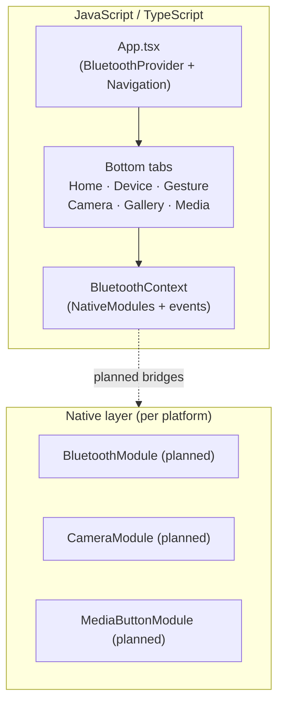
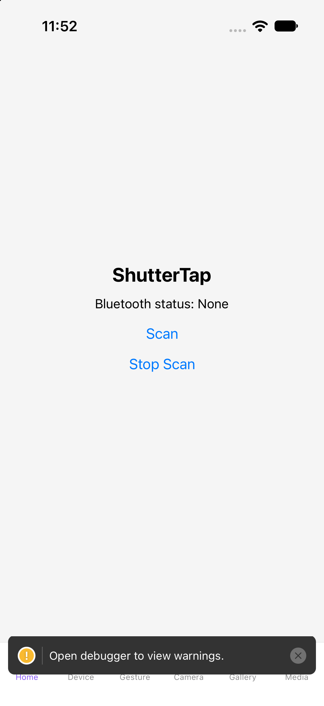

<div align="center">

# ShutterTap

**Trigger your phone camera with Bluetooth earbud gestures.**

[](https://docs.expo.dev/versions/v57.0.0/)
[](https://reactnative.dev/)
[](https://github.com/thenameisomm/ShutterTap)

</div>

## Table of contents

- [Overview](#overview)
- [Problem](#problem)
- [Key features](#key-features)
- [How it works](#how-it-works)
  - [Technology stack](#technology-stack)
  - [Architecture](#architecture)
  - [Project structure](#project-structure)
- [Screenshots](#screenshots)
- [Prerequisites](#prerequisites)
- [Installation and setup](#installation-and-setup)
- [Android development](#android-development)
- [iOS development](#ios-development)
- [Testing](#testing)
- [Current limitations](#current-limitations)
- [Roadmap](#roadmap)
- [Contributing](#contributing)
- [License](#license)

## Overview

ShutterTap is a cross-platform mobile app built with React Native and
Expo development builds. It connects to Bluetooth earbuds, maps hardware
media-button gestures (single/double/triple tap, long press) to camera
actions (take photo, record video, switch camera, toggle flash), and
shows captured media in an on-device gallery.

The app is under active stabilization: the iOS simulator Debug build
launches and renders, and the Android Debug build compiles. Native
Bluetooth/camera/media-button bridges are the next milestone —
see [Current limitations](#current-limitations).

## Problem

Taking a group photo or a hands-free video with the rear camera means
either a timer sprint or touching the phone and shaking the shot.
ShutterTap turns the buttons already in your ears into a wireless
shutter remote: tap an earbud to capture the moment without touching
the phone.

## Key features

| Feature | Status |
|---|---|
| Bottom-tab navigation (Home, Device, Gesture, Camera, Gallery, Media) | Implemented and rendering |
| Bluetooth scan / connect UI with connection-state sync | UI implemented, native bridge planned |
| Gesture-to-camera-action mapping screen | UI implemented, native bridge planned |
| Camera preview, photo, video, flash, camera switch | UI implemented, native bridge planned |
| Media-button event feed | UI implemented, native bridge planned |
| Gallery with empty / loading / error states | UI implemented, native listing planned |
| Light / dark themes | Implemented |
| iOS scene-lifecycle startup (Xcode 27 SDK requirement) | Implemented and verified |

Statuses are honest labels: *implemented* means on-screen and exercised;
*planned* means the UI exists but the native module behind it does not
yet. Nothing here is claimed working on hardware until it is tested on
hardware.

## How it works

### Technology stack

- **Expo SDK 57** with prebuild-managed native projects and
  development builds (`expo run:android`, `expo run:ios`).
  Expo Go is **not** supported — the app needs custom native code.
- **React Native 0.86.3** + **React 19.2.3**, Hermes engine,
  New Architecture (Fabric).
- **React Navigation** bottom tabs. No Expo Router.
- TypeScript, ESLint, Jest + React Native Testing Library preset.
- Android: Gradle 9.x, Android Gradle Plugin 8.x, Kotlin, JDK 21.
- iOS: Xcode 27 (iOS 27 SDK), Swift `SceneDelegate`, CocoaPods via
  Bundler, single-scene `UIApplicationSceneManifest`.

### Architecture



- `App.tsx` + `index.js` register the `"main"` component expected by
  both native entry points.
- `src/state/BluetoothContext.tsx` is the single source of Bluetooth
  UI state, fed by native events once the bridges land.
- Android entry: `MainActivity` / `MainApplication`
  (`com.anonymous.shuttertap`). iOS entry: `AppDelegate` (Expo) +
  `SceneDelegate` (window + React Native startup from the scene).
- Metro bundling uses `expo/metro-config`. Details live in
  [`ARCHITECTURE.md`](ARCHITECTURE.md).

### Project structure

```text
ShutterTap/
├── App.tsx                 # Root: providers + navigation
├── index.js                # JS entry (registers "main")
├── src/
│   ├── screens/            # Home, Device, Gesture, Camera, Gallery, MediaButton
│   ├── components/         # AppIcon, layout/button/state/device primitives
│   ├── navigation/         # Bottom-tab navigator
│   ├── state/              # BluetoothContext
│   ├── native/             # Centralized native-bridge accessor (modules.ts)
│   ├── types/              # Shared models (devices, gestures, actions)
│   └── theme.ts            # Design tokens + light / dark themes
├── android/                # Expo-managed native project (Gradle, Kotlin)
├── ios/                    # Expo-managed native project (Swift, Pods)
├── __tests__/              # Jest tests
├── docs/images/            # Screenshots used below
├── ARCHITECTURE.md         # Verified architecture + decision record
├── TESTING.md              # Repeatable test instructions
└── TEST_CHECKLIST.md       # Manual hardware test checklist
```

## Screenshots

Genuine capture from the iOS simulator Debug build (Home tab rendering;
Bluetooth shows “None” because the native bridge is not yet ported):



More screenshots (Device, Camera, Gallery tabs, Android) will be added
as features are verified — see
[`docs/images/`](docs/images/).

## Prerequisites

- **Node.js** 22.11+ and **npm** (this repo uses `package-lock.json`
  only — do not mix Yarn or pnpm).
- **Android:** JDK 21 and the Android SDK with `ANDROID_HOME` set
  (e.g. `~/Library/Android/sdk` on macOS). The Gradle wrapper in
  `android/` is committed — no global Gradle install needed.
- **iOS** (macOS only): Xcode 27 and Bundler (`bundle install` fetches
  the pinned CocoaPods). Run a single simulator at a time.
- No physical device is needed to build; Bluetooth, camera, and
  media-button features require real hardware to verify.

## Installation and setup

```sh
git clone https://github.com/thenameisomm/ShutterTap.git
cd ShutterTap
npm install
bundle install              # macOS, first time only (installs CocoaPods)
bundle exec pod install --project-directory=ios
```

Start exactly one Metro bundler:

```sh
npx expo start --dev-client
```

Available scripts (`package.json`):

| Command | Purpose |
|---|---|
| `npm start` | Start Metro for development builds |
| `npm run android` | Build + run Android development build |
| `npm run ios` | Build + run iOS development build |
| `npm test` | Run Jest tests |
| `npm run lint` | Run ESLint |

## Android development

```sh
# Terminal 1
npx expo start --dev-client
# Terminal 2 (needs ANDROID_HOME set)
npx expo run:android
```

- Direct Gradle build: `cd android && ./gradlew assembleDebug`.
- Logs: `adb logcat` (filter by the app package).
- Debug signing: the local `android/app/debug.keystore` is intentionally
  **not** committed. Generate one locally before your first Debug build:
  ```sh
  keytool -genkey -v -keystore android/app/debug.keystore \
    -alias androiddebugkey -storepass android -keypass android \
    -keyalg RSA -validity 10000 -dname "CN=Android Debug,O=Android,C=US"
  ```
- Release packaging (`export:embed` bundle) is validated separately from
  Debug builds — a working Debug app does not imply a verified Release.

## iOS development

```sh
# Terminal 1
npx expo start --dev-client
# Terminal 2
npx expo run:ios -d "iPhone 17"
```

- First-time / after native-dependency changes:
  `bundle exec pod install --project-directory=ios`.
- The project adopts the UIKit scene lifecycle required by the Xcode 27
  SDK (`SceneDelegate` + scene manifest in `Info.plist`); do not move
  window creation back into `AppDelegate`.
- Never run `expo prebuild --clean` without a backup — `ios/` holds the
  maintained native project.
- Logs: Xcode console / Console.app, or
  `xcrun simctl spawn booted log show --predicate 'process == "ShutterTap"'`.

## Testing

```sh
npx tsc --noEmit
npx eslint .
npm test
npx expo-doctor
```

- `TESTING.md` has the repeatable Android / iOS / release / performance
  workflows; `TEST_CHECKLIST.md` covers the manual hardware pass.
- Report results honestly as passed / failed / not run / blocked, and
  distinguish UI vs. bridge vs. emulator vs. physical-device verification.

## Current limitations

- **Native bridges not yet ported:** `BluetoothModule`, `CameraModule`,
  and `MediaButtonModule` do not exist yet, so those screens show
  explicit “unavailable” states instead of live data.
- **No hardware verification yet:** Bluetooth discovery/connection,
  camera capture, media-button events, and gallery listing all require
  physical devices and are untested.
- **Android emulator:** no system images are bundled; obtain them via
  the SDK Manager before running an AVD.
- **Release builds** have not been validated end to end.
- **Android 16 KB page-size** compatibility is diagnosed from packaged
  artifacts first — no blanket linker flags.

## Roadmap

1. Port Bluetooth / Camera / MediaButton native modules + manifest entries.
2. Validate Debug runs on one Android device and one iPhone.
3. Complete the `TEST_CHECKLIST.md` hardware pass.
4. Validate Release packaging (Android AAB/APK, iOS archive) with no
   dev-server dependency.
5. Resolve 16 KB page-size findings from real artifacts.
6. Polish UI, accessibility, and gallery performance.

## Contributing

Issues are welcome — one real bug or improvement per issue, with steps
to reproduce, expected vs. actual behavior, device/OS/app versions, and
relevant logs (redact secrets). For changes: create a focused branch
(e.g. `feat/bluetooth-scan-connect`, `fix/ios-startup-stability`,
`docs/testing-workflow`), run the checks in [Testing](#testing), review
your diff, and open a pull request. Prefer meaningful commits over many
tiny ones. Internal planning notes (`TODO.md`, `PROGRESS.md`, agent
instructions) stay local and are not part of pull requests.

## License

No license has been chosen yet. Until a `LICENSE` file is added, all
rights are reserved by the project owner — do not redistribute or use
this code beyond review without permission.
